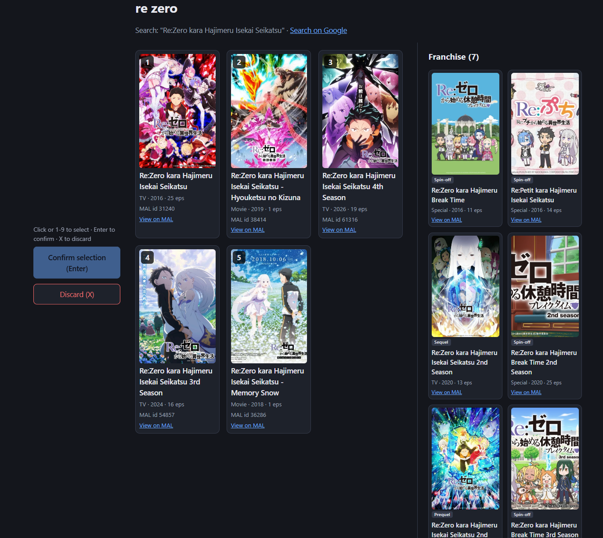
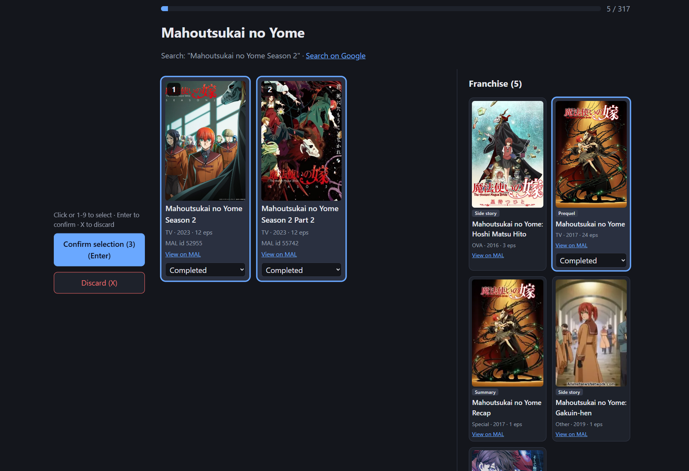
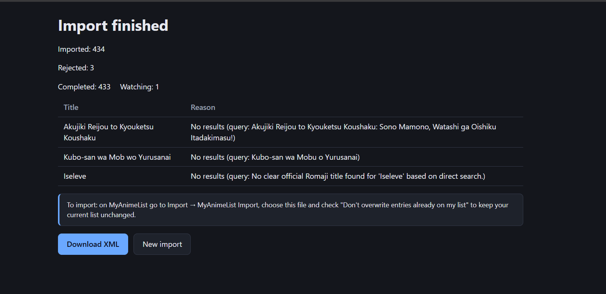
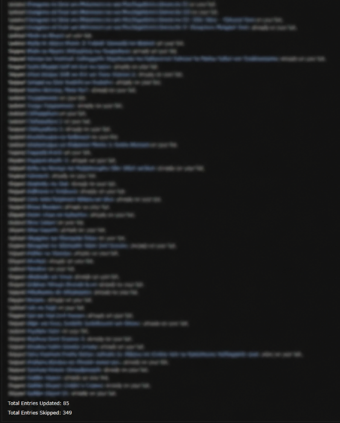

# Anime Importer

[](https://github.com/Psmithortiz/Anime-importer/actions/workflows/ci.yml)

Turn a messy, hand-written anime list into a clean [MyAnimeList](https://myanimelist.net/) import file.

Gemini normalizes each line (typos, mixed Spanish/English/romaji, personal notes like `S2 ***` or
`MANGA?`), the official MAL API finds the matching entries, and a small web UI with posters lets you
resolve the ambiguous ones, pick several seasons at once and set a list status for each. The result is a
native MAL XML file that you can import safely.



## Why this exists

Over the years I kept a list of the ~300 anime I had watched in a Word document, with inconsistent
spelling, three languages and my own shorthand for seasons. Existing importers expected clean data.
This tool handles the mess.

The first version (May 2026) was a working script with a Flask UI. This version is a full rewrite with a
layered architecture, tests and a proper API, built as a backend portfolio project.

## Features

- **LLM normalization** with Gemini 2.5 Flash and Google Search grounding, in chunks, with retries
  tuned per error type (rate limit, overload, malformed output).
- **Per-title normalization cache**: a failed or interrupted run never pays twice for titles it
  already normalized, and editing the list only costs the new lines.
- **Fuzzy matching** against each candidate's main and alternative titles (English, Japanese, synonyms).
- **Fallback to your own line**: when the normalized title finds nothing on MAL, the original line is
  searched instead, and it is always offered as an option when the normalizer is unsure.
- **Web UI** with posters, media type, year, episode count and airing status
  (*Airing*, *Not yet aired*).
- **Multi-select** with a per-entry list status (*Completed*, *Watching*, *Plan to Watch*, …),
  suggested from the airing status.
- **Franchise discovery**: a breadth-first walk over MAL relations shows sequels, prequels, OVAs and
  movies next to the candidates, so one line of the list can import a whole series.
- **Look-ahead resolution**: a background worker resolves upcoming titles while you answer, after a
  short initial buffer, so most questions appear instantly.
- **Keyboard-first**: `1`–`9` to select, `Enter` to confirm, `X` to discard, `Ctrl+Z` to undo.
- **Resumable sessions**: every import is saved in SQLite, so you can restart the server and pick
  up exactly where you left off, even after a failure.
- **Unlimited undo** with `Ctrl+Z`: step back through your answers one by one, also after the
  last question.
- **Recent sessions** on the start screen, to reopen any import in progress or finished.
- **Retry when MAL fails**: a session that stopped because a lookup failed is rebuilt from the
  database with one click, without losing a single answer.
- **REST API** documented automatically at `/docs`, plus an interactive CLI.
- **Demo mode** (`DEMO=1`): replays recorded Gemini and MAL responses, so you can try the whole
  flow without API keys.


*Picking Season 2 and Part 2 from the candidates, and the Season 1 prequel from the franchise column.*
## How it works

```
anime_list.txt
   │
   ▼
Gemini normalization ──── per-title cache (JSON on disk, versioned by model + prompt)
   │   ambiguous? ──► ask: which title should I search for?
   ▼
MAL search (official API v2, throttled)
   │
   ▼
Fuzzy match (main + alternative titles)
   ├─ exactly one candidate ≥ 95 ──► accepted automatically, status suggested from airing status
   └─ otherwise ──► ask: pick one or more candidates, each with a list status
   ▼
MAL XML export (import with "Don't overwrite entries already on my list")
```

## Architecture

```
src/anime_importer/
├── domain/        Pure models and rules. No I/O, no frameworks.
│   ├── models.py, matching.py   Dataclasses, enums and fuzzy matching.
│   └── session.py               Steps, resolutions, user decisions and stored snapshots.
├── ports.py       Protocols the core depends on (AnimeSearcher, TitleNormalizer,
│                  SessionRepository) and their errors.
├── adapters/      The outside world: Gemini, MAL, caches, XML and text files, demo replay.
│   ├── sqlite_repository.py     Sessions in SQLite (one connection per operation, WAL).
│   ├── memory_repository.py     The same contract in memory (CLI and tests).
│   └── session_codec.py         JSON serialization of resolutions and decisions.
├── services/      ImportSession: the state machine that drives an import and pauses for questions.
├── api/           FastAPI app, Pydantic schemas, session registry and the static frontend.
├── cli.py         Interactive terminal interface over the same service.
└── bootstrap.py   Composition root: the only place that wires concrete adapters together.
```

Dependencies point inward: `api / cli → services → domain ← adapters`. The domain never imports an
HTTP client, an SDK or a web framework, so it is tested without network access or API keys.
Outside the package, `scripts/record_demo.py` records the demo data with the real adapters (it
needs API keys).

## Design decisions

**Ports and adapters, proven the hard way.** The first version searched through Jikan, an unofficial
MAL mirror. In October 2026 Jikan's public API was discontinued. Because the service only depends on an
`AnimeSearcher` protocol, switching to the official MAL API meant writing one adapter and changing one
line in `bootstrap.py`. Each adapter also translates its own errors (`requests` exceptions become
`SearchError`) and its own vocabulary (`"currently_airing"` becomes `AiringStatus.AIRING`), so the core
never learns provider details.

**A state machine instead of a global dict.** An import pauses for user input between HTTP requests.
`ImportSession` models each pause as a typed step (`NormalizationChoice`, `CandidateChoice`,
`Finished`), so an invalid combination (a normalization phase holding search results) cannot be built.
Every mutating method validates first and changes state second: a bad selection never leaves the session
half-updated.

**Background work with polling.** Preparing an import takes minutes, so `POST /api/sessions` returns
`202 Accepted` immediately and the frontend polls the session, showing progress for both phases. A lock
serializes actions on a session (a double click can't advance it twice), but reads never take the lock,
so polling stays responsive. Endpoints are plain `def`: they call blocking code, which FastAPI runs in a
thread pool instead of stalling the event loop.

**Sessions as an event log.** What gets saved is the input list, what Gemini and MAL computed for
each title, and the user's decisions, identified by query text and MAL id rather than by option
number. The state of a session is never stored: it is rebuilt by replaying those decisions over the
stored results, which is how a session resumes after a restart. Every fact is saved *before* it is
applied, so nothing is ever applied that could not be persisted. Undo is just removing the last
decision and replaying: it returns to the last answered question and never repeats a search, because
the results and the answers to earlier searches are kept. The consumer-side state is published with
copy-on-write (each action works on a copy and swaps it in with a single assignment), so the
lock-free readers behind the polling endpoint never see a half-applied step. The adapters are built
once per app and shared by all sessions, so MAL's rate limit and the JSON caches are not duplicated
when several sessions are open.

**Franchise discovery as a breadth-first search.** MAL only exposes `related_anime` on each anime's
detail endpoint, so the franchise is a graph explored one request per node. Relations are mutual
(S1 → S2 is a *sequel*, S2 → S1 a *prequel*), so nodes are marked visited when they are **enqueued**, not
when they are processed — otherwise two seasons pointing at the same OVA would queue it twice. Only
in-continuity relations are expanded (sequel, prequel, side story, summary and their inverses);
spin-offs and alternative versions are shown but not followed, and character crossovers are ignored, so
a walk from *Re:Zero* never wanders into *Overlord*. A node cap bounds huge franchises, and details are
cached per MAL id for seven days. If the matched title has a franchise, the question is shown even when
the match itself was certain: that is how forgotten first seasons and announced sequels surface.

**Look-ahead resolution, like a video buffer.** Each title needs a search plus a franchise walk, which
at one request per second is too slow to do after every answer. A background worker resolves titles in
order and appends each *resolution* (import, reject or ask) to a list; answering a question only
*applies* the next resolution. The first question appears once an initial buffer is ready, and the
worker keeps going while you answer, so most questions show up instantly. The worker and the request
threads coordinate through a `threading.Condition` (no polling loops), never hold a lock during network
I/O, and share a single thread-safe throttle so MAL's rate limit holds across both. In tests, the
background runner is injected and runs synchronously, which keeps the suite deterministic.

**Cache by title, not by chunk.** Gemini answers a whole chunk or nothing, but results are stored per
title, keyed by the lightly normalized input line and versioned by a hash of the model and prompt.
A callback persists each chunk as soon as it validates, with atomic writes, so a quota error in chunk 11
keeps chunks 1–10. Inserting a title, reordering the list or changing the chunk size invalidates nothing.

**Matching bugs found with real data.** Two examples:
- The query sanitizer deleted punctuation, turning `Geiko-hen` into `Geikohen`. MAL's search requires
  every word to match, so modern season titles returned nothing. Symbols now become spaces.
- Fuzzy matching originally mapped results back by title text, so two entries with the same title
  collapsed into one. Matching now keeps candidate identity, and a tie above the threshold is never
  auto-accepted.

**Reading the import contract carefully.** I first assumed `update_on_import=0` meant "add only what's
missing". The real import showed MAL *ignores* those entries; protecting an existing list is done with
MAL's own "Don't overwrite entries already on my list" checkbox. The export now always sets `1` and the
UI tells you which box to check.

**No frontend framework.** The UI is plain HTML, CSS and JavaScript served by FastAPI. All data from
external APIs is inserted with `textContent`, never `innerHTML`, to rule out XSS from titles.

**Demo mode as a second swap of adapters.** `DEMO=1` makes `bootstrap.py` build replaying
adapters instead of Gemini and MAL; the domain and the service do not change. The data is not
written by hand: `scripts/record_demo.py` wraps the real adapters in recorders and walks a full
import, including every option of ambiguous titles, so the demo replays real responses. The
recording format is deliberately independent from the details cache, so changing one never
invalidates the other.

**A small, safe container.** The image is built in two stages: the first resolves dependencies with
uv (cached as its own layer, so code changes don't reinstall them), the second copies only the
virtual environment and runs as a non-root user. `.dockerignore` is an allowlist, so local
caches and secrets can never end up in the image; keys are entered at run time. The server binds to `0.0.0.0`
only inside the container (through the `HOST` setting, so there is still a single entry point),
and compose publishes it on `127.0.0.1` only, because the app has no authentication.

**A desktop launcher without races.** The launcher binds the socket itself and hands it to uvicorn.
Because it is already listening, the browser can be opened immediately (the OS queues the connection
until the server accepts it), and there is no gap between "check that the port is free" and "use
it". If the port is taken, the launcher asks `/api/info` to tell one of its own instances from
another program. On Windows it uses `SO_EXCLUSIVEADDRUSE`, because `SO_REUSEADDR` would let a second
process take a port that is already in use.

## Setup

### Windows app (no Python needed)

Download the zip from the [Releases](https://github.com/Psmithortiz/Anime-importer/releases) page,
unzip it and run `AnimeImporter.exe`. The `.exe` needs the `_internal` folder next to it: move the
whole `AnimeImporter` folder, or make a shortcut to the `.exe`, but never the `.exe` alone. A console
window opens together with your browser; closing the console stops the app. The first time, the
Settings screen asks for your API keys. To try the demo without keys, open PowerShell in that folder
and run `$env:DEMO="1"; .\AnimeImporter.exe`.

The executable is not signed, so Windows may show "Windows protected your PC" (SmartScreen). Click
"More info" and then "Run anyway". To check that the zip is the one that was published, compare
`Get-FileHash <zip> -Algorithm SHA256` with the `.sha256` file of the release.

macOS and Linux users can use [Docker](#docker), [uvx](#quick-run-no-clone) or the
[source code](#from-source).

The rest of the options below require Python 3.13 and [uv](https://docs.astral.sh/uv/).

### Try it without API keys

Demo mode replays real Gemini and MyAnimeList responses recorded for a sample list, so it needs
no API keys and no network access to the APIs:

```bash
DEMO=1 uvx --from git+https://github.com/Psmithortiz/Anime-importer anime-importer-web
```

On Windows PowerShell: `$env:DEMO="1"; uvx --from git+https://github.com/Psmithortiz/Anime-importer anime-importer-web`

The sample list is preloaded. Titles outside it won't be found.

### Docker

```bash
docker compose up --build
```

Open <http://127.0.0.1:8000>. It starts in demo mode. To use your own keys, run
`DEMO=0 docker compose up` (PowerShell: `$env:DEMO="0"; docker compose up`) and enter the keys in the
Settings screen.
Normalization and MAL caches, and your sessions, are kept in Docker volumes between runs.
The `data` volume also holds the config file with your keys (`/home/app/data/config.json`). It is
user data: unlike the cache volume, do not delete it to free space.

### Quick run (no clone)

With [uv](https://docs.astral.sh/uv/) installed, you can run the web UI straight from GitHub:

```bash
uvx --from git+https://github.com/Psmithortiz/Anime-importer anime-importer-web
```

Open the Settings screen it shows and enter your keys: they are saved in the per-user config file
(see "Where files are stored"). Caches and sessions live in per-user folders too, so it does not
matter which folder you run it from.

### From source

```bash
git clone https://github.com/Psmithortiz/Anime-importer
cd Anime-importer
uv sync
```

The app starts even without API keys and shows a **Settings** screen that asks for them (links
to Google AI Studio and MAL's API page included). The keys are saved in the per-user config file
(see below). Get them at https://aistudio.google.com/apikey (Gemini) and
https://myanimelist.net/apiconfig (MAL client ID). Environment variables still work and win over the
file:

```
GEMINI_API_KEY=your_gemini_key
MAL_CLIENT_ID=your_mal_client_id
```

A `.env` file is **not** read.

The CLI (`anime-importer`) has no settings screen: without keys it names the missing ones and exits
with code 2.

Optional settings: `GEMINI_MODEL` and `GEMINI_CHUNK_SIZE` (default 20). The paths of the caches,
sessions and config file are described below.

To build the Windows executable locally:
`uv run --group build pyinstaller packaging/anime-importer.spec --noconfirm` (the result is in
`dist/AnimeImporter/`).

### Where files are stored

Caches, sessions and settings live in per-user folders, never in the current folder:

| What | Default location (Windows / Linux / macOS) | Variable to change it |
| --- | --- | --- |
| Normalization cache | `%LOCALAPPDATA%\anime-importer\Cache\normalization` / `~/.cache/anime-importer/normalization` / `~/Library/Caches/anime-importer/normalization` | `NORMALIZATION_CACHE_DIR` |
| MAL details cache | `mal_details.json` in the same cache folder | `DETAILS_CACHE_PATH` |
| Sessions | see below | `DATABASE_PATH` (`DEMO_DATABASE_PATH` in demo mode) |
| Config file | `%LOCALAPPDATA%\anime-importer\config.json` / `~/.config/anime-importer/config.json` / `~/Library/Application Support/anime-importer/config.json` | `ANIME_IMPORTER_CONFIG_FILE` |

Settings are read in this order of priority (highest first): environment variables, the
config file (a JSON object such as `{"gemini_api_key": "...", "mal_client_id": "..."}`), and the
defaults. A missing config file is ignored; an invalid one stops the app with an error naming it.
Computing these paths creates nothing: folders are created when something is first written.

**The Settings screen.** It shows where each key comes from (environment variable or config file)
and the last 4 characters of the saved key, never the full value. A key that comes from the
environment cannot be edited there (it would be overridden anyway): change it where it is
defined (if every key comes from the environment, the screen says so and Save is disabled). The
link in the header is only hidden in demo mode. If the app started without keys, saving them starts it right away. If it was already
configured, the new keys are saved but the running app keeps the old ones until you restart it:
the adapters (MAL throttle, caches) are built once per app, and a second set would share neither.
The config file is created with owner-only permissions on Linux and macOS; on Windows it inherits
the permissions of your user folder.

**Host header check.** The web server only answers requests whose `Host` header is `127.0.0.1` or
`localhost`. This protects the keys and your sessions from DNS rebinding (a web page making your
browser talk to the local server under another name). If you expose the app under another name,
add it with `ALLOWED_HOSTS` as a JSON list, e.g. `ALLOWED_HOSTS='["127.0.0.1","localhost","anime.lan"]'`.

**Upgrading from an earlier version.** If you used a `.env` file, it is no longer read: paste your
keys in the Settings screen (or use environment variables).

Caches used to live in `.cache/` inside the folder where the
app was run. To keep them (and not spend Gemini quota again), move the contents of
`.cache/normalization` and the file `.cache/mal_details.json` to the new cache folder. Nothing is
migrated automatically.

### Where sessions are stored

Sessions live in a SQLite file named `sessions.db` (`demo.db` in demo mode) inside the per-user data
folder of your system: `%LOCALAPPDATA%\anime-importer` on Windows, `~/.local/share/anime-importer`
on Linux and `~/Library/Application Support/anime-importer` on macOS. Set `DATABASE_PATH` (and
`DEMO_DATABASE_PATH`) to use another location. It is not the current folder on purpose: with
`uvx` the server can be started from anywhere, and a fixed location keeps "Recent sessions"
complete no matter where you launch it. Computing the path creates nothing; the folder is created
when the app starts.

## Usage

### Web UI

```bash
uv run anime-importer-web
```

Open <http://127.0.0.1:8000>, paste your list or load a `.txt` file (one title per line) and start.
The API documentation is at <http://127.0.0.1:8000/docs>.

Download the XML at the end and import it from
[MAL's import page](https://myanimelist.net/import.php) (choose *MyAnimeList Import*). Check
*Don't overwrite entries already on my list* to keep your current list unchanged.

### CLI

```bash
uv run anime-importer --input anime_list.txt --output output.xml
```

## Rate limits

- **Gemini 2.5 Flash, free tier**: 5 requests per minute and 20 per day. A 317-title list takes 16
  requests with the default chunk size. If the daily quota runs out, switch keys and restart: the cache
  keeps everything already normalized.
- **MAL API**: requests are throttled to one per second.

## Testing

```bash
uv run pytest
uv run ruff check src tests
```

The suite runs without network access, API keys or real waits: adapters accept injected
sessions, clients, clocks and sleep functions.

The session repository is covered by contract tests: the same battery runs against the in-memory
and the SQLite implementations, so both are guaranteed to behave identically. SQLite-only tests
cover reopening a file, schema versions and cascading deletes.

CI runs both commands on Ubuntu and Windows for every pull request, and builds the Docker image
with a demo-mode smoke test.

## Known limitations

- The desktop launcher only detects an already running instance on port 8000. If another program
  uses 8000, every launch opens a new instance on a free port. SQLite in WAL mode prevents
  corruption, but it is best to use a single window.

## Roadmap

- Full pipeline: overlap Gemini normalization and MAL resolution.

## Results

Run end to end on my real list of 317 hand-written lines:

| | Version 1 (May 2026) | Version 2 |
|---|---|---|
| Lines resolved | 305 / 309 (98.7%) | 314 / 317 (99.1%) |
| MAL entries exported | 305 | 434 (franchise discovery added ~120 seasons, movies and OVAs) |
| Manual discards | 4 | 0 |



Importing the file with *Don't overwrite entries already on my list* left the 349 entries I already
had untouched and added 85 that were missing — mostly first seasons and side entries of franchises I
had only partially logged by hand.



The 3 remaining lines each exposed a different issue: a query cut mid-word by the 64-character limit, a
normalization that was worse than the original line (the LLM "corrected" `Mob wo` to `Mobu o`, and
expanded an anime title to its manga's full name), and an abbreviation the LLM didn't recognize. Cutting
at word boundaries and falling back to the original line now resolve all three.

## License

MIT