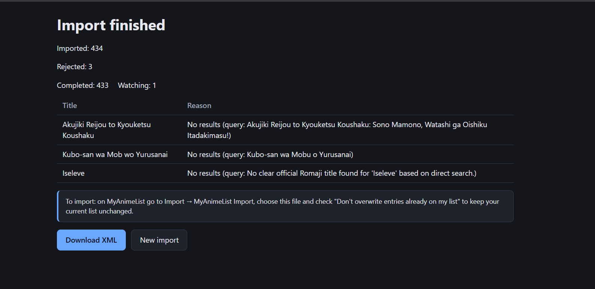

# Setup and usage

Back to the [README](../README.md).

## Setup

### Windows app (no Python needed)

Download the zip from the [Releases](https://github.com/Psmithortiz/Anime-importer/releases) page,
unzip it and run `AnimeImporter.exe`. The `.exe` needs the `_internal` folder next to it: move the
whole `AnimeImporter` folder, or make a shortcut to the `.exe`, but never the `.exe` alone. A console
window opens together with your browser; closing the console stops the app. The first time, the
Settings screen asks for your API keys. To try the demo without keys, open PowerShell in that folder
and run `$env:DEMO="1"; .\AnimeImporter.exe`.

The executable is not signed, so Windows may show "Windows protected your PC" (SmartScreen). Click
"More info" and then "Run anyway". To check that the zip is the one that was published, compare
`Get-FileHash <zip> -Algorithm SHA256` with the `.sha256` file of the release.

macOS and Linux users can use [Docker](#docker), [uvx](#quick-run-no-clone) or the
[source code](#from-source).

The rest of the options below require Python 3.13 and [uv](https://docs.astral.sh/uv/).

### Try it without API keys

Demo mode replays real Gemini and MyAnimeList responses recorded for a sample list, so it needs
no API keys and no network access to the APIs:

```bash
DEMO=1 uvx --from git+https://github.com/Psmithortiz/Anime-importer anime-importer-web
```

On Windows PowerShell: `$env:DEMO="1"; uvx --from git+https://github.com/Psmithortiz/Anime-importer anime-importer-web`

The sample list is preloaded. Titles outside it won't be found.

### Docker

```bash
docker compose up --build
```

Open <http://127.0.0.1:8000>. It starts in demo mode. To use your own keys, run
`DEMO=0 docker compose up` (PowerShell: `$env:DEMO="0"; docker compose up`) and enter the keys in the
Settings screen.
Normalization and MAL caches, and your sessions, are kept in Docker volumes between runs.
The `data` volume also holds the config file with your keys (`/home/app/data/config.json`). It is
user data: unlike the cache volume, do not delete it to free space.

### Quick run (no clone)

With [uv](https://docs.astral.sh/uv/) installed, you can run the web UI straight from GitHub:

```bash
uvx --from git+https://github.com/Psmithortiz/Anime-importer anime-importer-web
```

Open the Settings screen it shows and enter your keys: they are saved in the per-user config file
(see "Where files are stored"). Caches and sessions live in per-user folders too, so it does not
matter which folder you run it from.

### From source

```bash
git clone https://github.com/Psmithortiz/Anime-importer
cd Anime-importer
uv sync
```

The app starts even without API keys and shows a **Settings** screen that asks for them (links
to Google AI Studio and MAL's API page included). The keys are saved in the per-user config file
(see below). Get them at https://aistudio.google.com/apikey (Gemini) and
https://myanimelist.net/apiconfig (MAL client ID). Environment variables still work and win over the
file:

```
GEMINI_API_KEY=your_gemini_key
MAL_CLIENT_ID=your_mal_client_id
```

A `.env` file is **not** read.

The CLI (`anime-importer`) has no settings screen: without keys it names the missing ones and exits
with code 2.

Optional settings: `GEMINI_MODEL` and `GEMINI_CHUNK_SIZE` (default 20). The paths of the caches,
sessions and config file are described below.

To build the Windows executable locally:
`uv run --group build pyinstaller packaging/anime-importer.spec --noconfirm` (the result is in
`dist/AnimeImporter/`).

### Where files are stored

Caches, sessions and settings live in per-user folders, never in the current folder:

| What | Default location (Windows / Linux / macOS) | Variable to change it |
| --- | --- | --- |
| Normalization cache | `%LOCALAPPDATA%\anime-importer\Cache\normalization` / `~/.cache/anime-importer/normalization` / `~/Library/Caches/anime-importer/normalization` | `NORMALIZATION_CACHE_DIR` |
| MAL details cache | `mal_details.json` in the same cache folder | `DETAILS_CACHE_PATH` |
| Sessions | see below | `DATABASE_PATH` (`DEMO_DATABASE_PATH` in demo mode) |
| Config file | `%LOCALAPPDATA%\anime-importer\config.json` / `~/.config/anime-importer/config.json` / `~/Library/Application Support/anime-importer/config.json` | `ANIME_IMPORTER_CONFIG_FILE` |

Settings are read in this order of priority (highest first): environment variables, the
config file (a JSON object such as `{"gemini_api_key": "...", "mal_client_id": "..."}`), and the
defaults. A missing config file is ignored; an invalid one stops the app with an error naming it.
Computing these paths creates nothing: folders are created when something is first written.

**The Settings screen.** It shows where each key comes from (environment variable or config file)
and the last 4 characters of the saved key, never the full value. A key that comes from the
environment cannot be edited there (it would be overridden anyway): change it where it is
defined (if every key comes from the environment, the screen says so and Save is disabled). The
link in the header is only hidden in demo mode. If the app started without keys, saving them starts it right away. If it was already
configured, the new keys are saved but the running app keeps the old ones until you restart it:
the adapters (MAL throttle, caches) are built once per app, and a second set would share neither.
The config file is created with owner-only permissions on Linux and macOS; on Windows it inherits
the permissions of your user folder.

**Host header check.** The web server only answers requests whose `Host` header is `127.0.0.1` or
`localhost`. This protects the keys and your sessions from DNS rebinding (a web page making your
browser talk to the local server under another name). If you expose the app under another name,
add it with `ALLOWED_HOSTS` as a JSON list, e.g. `ALLOWED_HOSTS='["127.0.0.1","localhost","anime.lan"]'`.

**Upgrading from an earlier version.** If you used a `.env` file, it is no longer read: paste your
keys in the Settings screen (or use environment variables).

Caches used to live in `.cache/` inside the folder where the
app was run. To keep them (and not spend Gemini quota again), move the contents of
`.cache/normalization` and the file `.cache/mal_details.json` to the new cache folder. Nothing is
migrated automatically.

### Where sessions are stored

Sessions live in a SQLite file named `sessions.db` (`demo.db` in demo mode) inside the per-user data
folder of your system: `%LOCALAPPDATA%\anime-importer` on Windows, `~/.local/share/anime-importer`
on Linux and `~/Library/Application Support/anime-importer` on macOS. Set `DATABASE_PATH` (and
`DEMO_DATABASE_PATH`) to use another location. It is not the current folder on purpose: with
`uvx` the server can be started from anywhere, and a fixed location keeps "Recent sessions"
complete no matter where you launch it. Computing the path creates nothing; the folder is created
when the app starts.

## Usage

### Web UI

```bash
uv run anime-importer-web
```

Open <http://127.0.0.1:8000>, paste your list or load a `.txt` file (one title per line) and start.
The API documentation is at <http://127.0.0.1:8000/docs>.

Download the XML at the end and import it from
[MAL's import page](https://myanimelist.net/import.php) (choose *MyAnimeList Import*). Check
*Don't overwrite entries already on my list* to keep your current list unchanged.



### CLI

```bash
uv run anime-importer --input anime_list.txt --output output.xml
```

## Rate limits

- **Gemini 2.5 Flash, free tier**: 5 requests per minute and 20 per day. A 317-title list takes 16
  requests with the default chunk size. If the daily quota runs out, switch keys and restart: the cache
  keeps everything already normalized.
- **MAL API**: requests are throttled to one per second.

## Testing

```bash
uv run pytest
uv run ruff check src tests
```

The suite runs without network access, API keys or real waits: adapters accept injected
sessions, clients, clocks and sleep functions.

The session repository is covered by contract tests: the same battery runs against the in-memory
and the SQLite implementations, so both are guaranteed to behave identically. SQLite-only tests
cover reopening a file, schema versions and cascading deletes.

CI runs both commands on Ubuntu and Windows for every pull request, and builds the Docker image
with a demo-mode smoke test.

## Known limitations

- The desktop launcher only detects an already running instance on port 8000. If another program
  uses 8000, every launch opens a new instance on a free port. SQLite in WAL mode prevents
  corruption, but it is best to use a single window.
